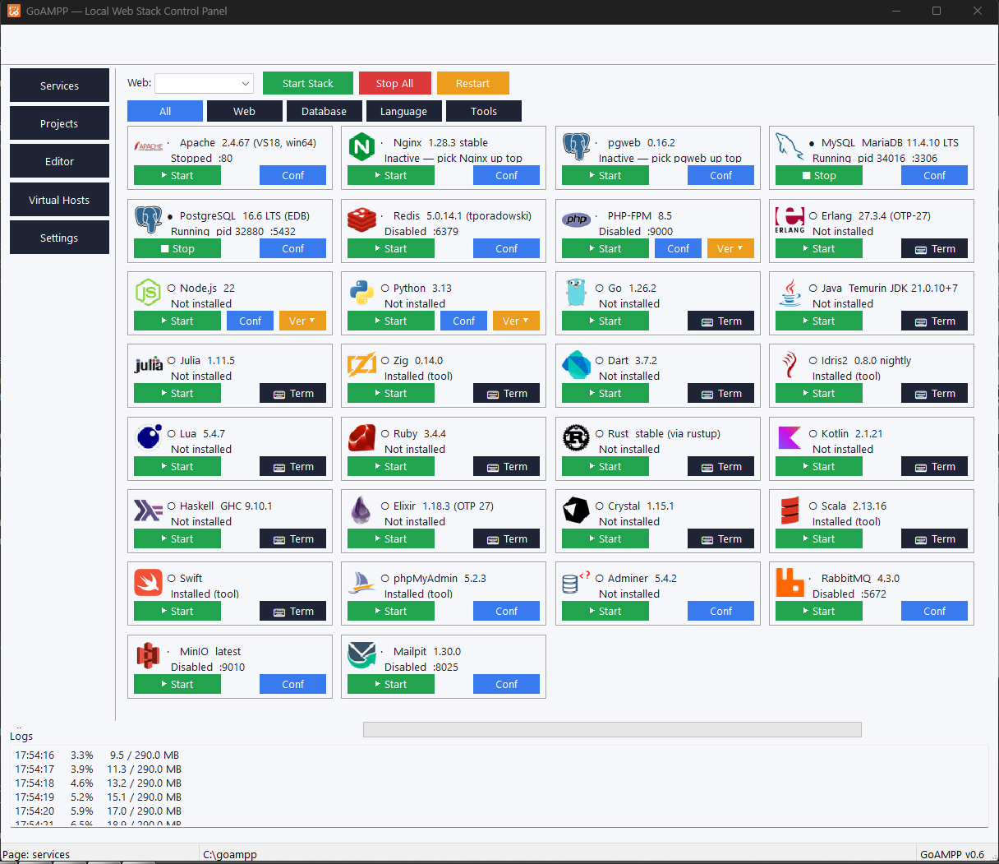
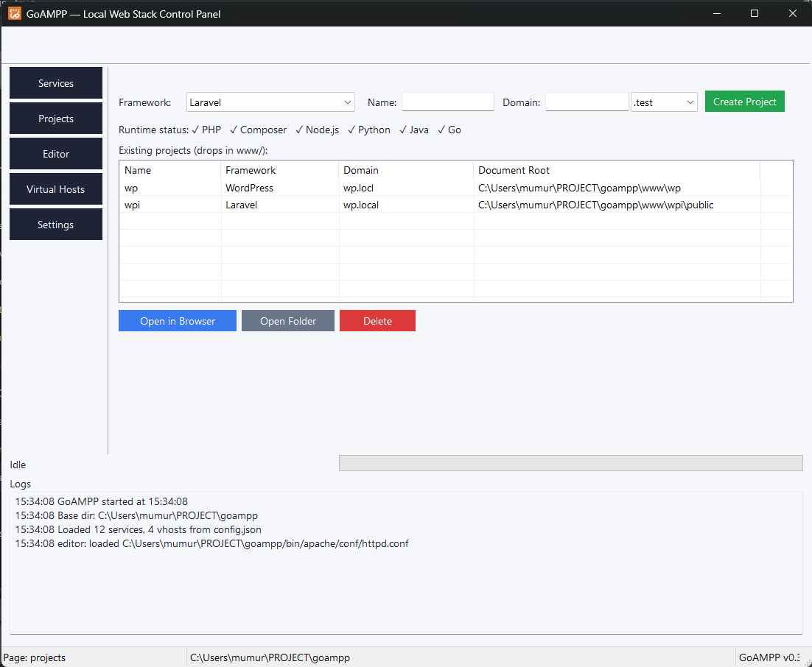
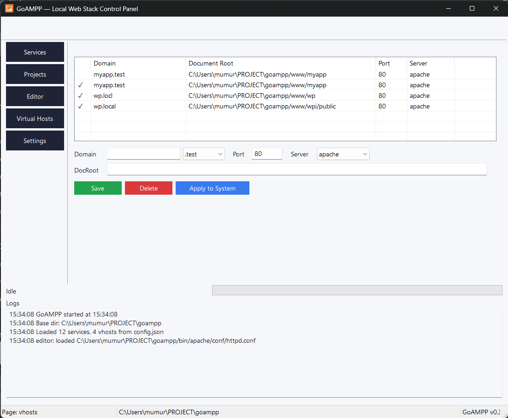
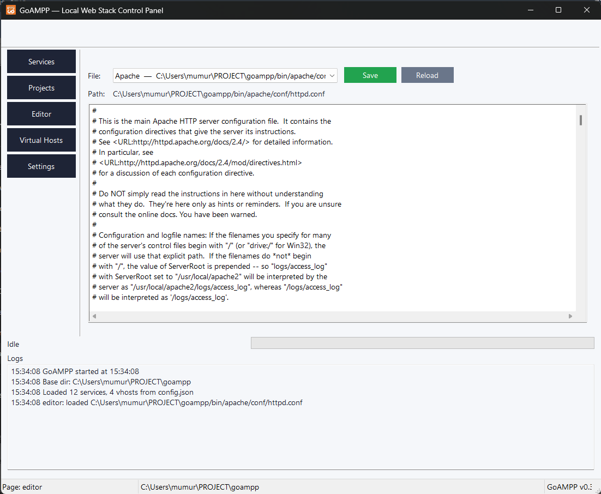
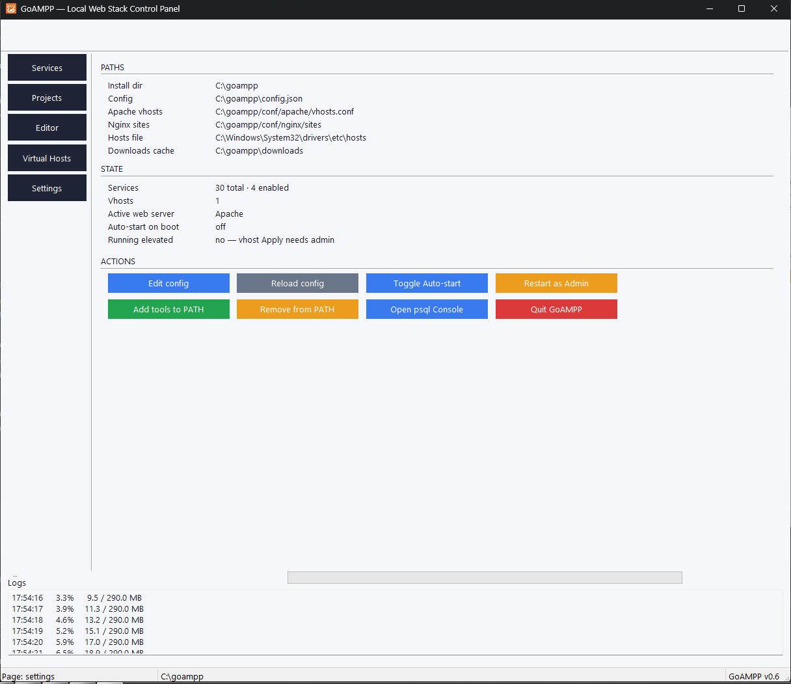

# GoAMPP

A native desktop web-stack control panel written in Go. On Windows, GoAMPP ships as **one self-contained `goampp.exe`** and downloads development tools on demand. On Linux, the initial native desktop port integrates with services and developer tools installed by your distribution, using systemd, OpenRC, or SysV init when available. Linux support is an early native mode and does not yet have full feature parity with Windows.

[](https://github.com/flessan/goampp-linux/releases/latest)
[](LICENSE)



## Features

### Windows

- **29 packages** in the catalog — Apache, Nginx, MariaDB (as MySQL), PostgreSQL, Redis, PHP, phpMyAdmin, Adminer, pgweb, Mailpit, RabbitMQ, Composer, and language runtimes from Node.js and Python to Go, Java, Rust, Zig and Elixir
- **Always the latest build** — every package resolves its newest release at install time from the official source (php.net, nodejs.org, MariaDB, Apache Lounge, GitHub releases, …), then falls back to the pinned URL and known archive mirrors when a link has gone 404
- **Version switching** — pick PHP 7.4–8.5, Node 18/20/22 or Python 3.10–3.13 from a dropdown; GoAMPP downloads it and restarts the service and the web server that loads it
- **Apache ⇄ Nginx in one click** — the old server stops and, if it was serving, the new one starts with regenerated vhosts
- **17 framework scaffolders** — Laravel, Livewire, Symfony, CodeIgniter 4, WordPress, Next.js, Vite + React, Express, NestJS, AdonisJS, Flask, Django, FastAPI, Go net/http, Gin, Spring Boot, Static HTML
- **Automatic virtual hosts** — saving a vhost or creating a project writes the hosts file, Apache `vhosts.conf` and Nginx `sites/`, then reloads the running web server
- **Update checks** — installed packages are compared with the latest releases twice a day; update one or all from the Services page
- **Fyne GUI** — compact list layout, light/dark theme that follows Windows, live activity log, per-package install progress
- **System tray** with close-to-tray and launch-with-Windows
- **Built-in config editor** (Ctrl+S to save), **"Add tools to PATH"**, **startup service selection**, **zombie process sweep** at launch

### Linux (native support)

- Native desktop dashboard with System and Dark appearances, searchable service/runtime cards, status activity, and in-app project logs; Light mode is not available yet, and contributions to implement it are welcome at [GitHub](https://github.com/flessan/goampp-linux)
- Detects common web servers, PHP-FPM, databases, Redis, RabbitMQ, and developer runtimes installed by the host distribution
- Starts/stops detected systemd, OpenRC, or SysV init services when the current account is authorized
- Config Editor can open common service configs or any text file; saves use an atomic replacement and a timestamped backup in the user cache. System files still require the permissions needed by the OS
- Virtual Hosts stores local host definitions, validates domains and document roots, and generates Apache/Nginx snippets and `/etc/hosts` mappings for review/copying. It does **not** silently edit system files or reload a server
- Startup page inspects boot-start state and can enable/disable services through systemd, OpenRC, or SysV init; privileged changes may require administrator authorization
- Creates starter projects for Static HTML, PHP, Node.js HTTP, Go net/http, and Python HTTP, plus framework recipes for Laravel, Livewire, Symfony, CodeIgniter, WordPress, Next.js, Vite + React, Express, NestJS, AdonisJS, Flask, Django, FastAPI, Gin, and Spring Boot
- Runs framework generators in the background, writes their output to project Logs, creates Python virtual environments locally for Python frameworks, and registers only known framework names for safe Run/Stop handling
- Uses distribution-managed packages rather than downloading Windows binaries; installing system packages remains an explicit user action
- Linux x86-64 releases provide `.AppImage`, `.deb`, `.rpm`, and `.tar.gz` downloads
- **Still not at full Windows parity:** GoAMPP's downloadable binary package catalog, automatic runtime/version switching, automatic system-wide virtual-host/hosts-file deployment, and Windows elevation workflow

## Screenshots

### Services
Every package grouped by kind, with status, version picker and one action button per row. Right-click a row for restart, config, terminal, folder, version and uninstall.


### Projects — auto-scaffold + auto-vhost
Pick a framework, type a name, click Create. Composer/npm/pip/go runs in the background, the vhost is registered and the web server reloaded.



### Virtual Hosts
Domains on the left, an editor on the right. The domain is split into name + extension so you can't accidentally hit HSTS-preloaded TLDs like `.dev`.



### Config editor
`httpd.conf`, `php.ini`, `my.ini`, `redis.conf`, `config.inc.php`, the Windows hosts file and `config.json` in a monospace editor.



### Settings
Theme, paths, PATH tools and about.



## Install on Windows

Grab the latest installer from the [Releases page](https://github.com/flessan/goampp-linux/releases/latest):

```
goampp-setup-X.Y.Z.exe
```

Installs to **`C:\goampp`** — the short path matches the XAMPP / Laragon convention and dodges MAX_PATH issues that bite deeply-nested project paths on Windows. The installer needs admin once (writing to the system drive root), but grants `users-modify` on the install folder so goampp itself runs unelevated after install. Only the one-time install plus future hosts-file edits (for virtual hosts) hit UAC.

A portable `goampp-vX.Y.Z-windows-amd64.zip` is published next to the installer.

## Install on Linux

Choose the package matching your distribution from the [Releases page](https://github.com/flessan/goampp-linux/releases/latest). Published assets are direct downloads, not a `.zip` wrapper:

- **AppImage:** `chmod +x goampp-vX.Y.Z-linux-amd64.AppImage && ./goampp-vX.Y.Z-linux-amd64.AppImage`
- **Debian, Ubuntu, Linux Mint:** `sudo apt install ./goampp-vX.Y.Z-linux-amd64.deb`
- **Fedora, RHEL-compatible distributions:** `sudo dnf install ./goampp-vX.Y.Z-linux-amd64.rpm`
- **Portable archive / per-user install:** extract the `.tar.gz` and run `sh ./install.sh`

The `.deb` and `.rpm` packages install the binary, desktop entry, and icon system-wide. The AppImage bundles most application libraries, but the host still supplies its display server and graphics driver. The archive installer registers GoAMPP for the current user. To remove that per-user installation, run `sh ./uninstall.sh` from the extracted archive; it preserves your projects in `~/GoAMPP/www`.

GitHub Actions automatically wraps workflow artifacts in a downloadable ZIP. Those are CI previews; release downloads above are published as individual `.AppImage`, `.deb`, `.rpm`, and `.tar.gz` files.

## First run (Windows)

1. **Click Install on any row** — GoAMPP downloads and extracts that package on the fly.
2. **Click "Start stack"** in the sidebar to install and boot the essential web stack (Apache or Nginx + PHP + MariaDB + phpMyAdmin) in one go.
3. **Open <http://localhost/phpmyadmin/>** — login as `root` with no password.
4. **Go to Projects** to scaffold a Laravel/Symfony/Express/Flask/Django/etc. project with its own `.test` domain.

## Linux native mode

Linux GoAMPP detects packages installed by your Linux distribution and can control available systemd, OpenRC, or SysV init services. Install only the components you need using your distribution's package manager first. GoAMPP does not request administrator privileges or install system packages automatically.

On Debian/Ubuntu, for example:

```bash
sudo apt install apache2 nginx php-fpm mariadb-server postgresql redis-server php-cli composer nodejs npm python3 python3-pip golang-go default-jdk
```

On Arch Linux, common equivalents are available through `pacman`; Fedora uses `dnf`. Package names and service unit names vary by distribution. Start/stop actions may require authorization from your system's service manager.

Open the **Services** tab to detect services, **Developer tools** to inspect runtimes, and **Projects** to open `~/GoAMPP/www` or `http://localhost/`. In **Projects**, choose a name and template, then select **Create project**. GoAMPP refuses unsafe names and existing directories. Framework recipes run their documented CLI commands only after you explicitly choose the framework and click **Create project**; they can download project dependencies, but GoAMPP does not silently install system packages or request administrator privileges. Each generated project includes a `README.md`; use its **Run** action to start the local development server, open the preview, and use **Stop** to terminate the process group. The Run action chooses an available local port for each launch to reduce port conflicts; the generated Node.js, Go, Static HTML, and Python HTTP servers read `GOAMPP_PORT`, while PHP receives its assigned port through the PHP server CLI arguments. Servers bind to `127.0.0.1` by default. All five starter templates serve from `public/`, keeping project-root files such as `README.md` and `.goampp-run.log` outside the document root. All five starter servers reject symlinks that resolve outside `public/`; the Static HTML, Node.js, Go, and Python HTTP servers also refuse to start if `public/` itself is a symlink, while the PHP router responds with HTTP 403. Output is appended to `.goampp-run.log` in the project directory. Closing GoAMPP stops any servers it started.

## Build from source

### Windows

Requires **Go 1.27+ (64-bit)** and a **MinGW-w64 `gcc`** on `PATH` — the Fyne GUI uses cgo. MSYS2's `mingw64` or `winget install BrechtSanders.WinLibs.POSIX.UCRT` both work.

```cmd
git clone https://github.com/flessan/goampp-linux
cd goampp-linux
build.bat 1.2.3
```

`build.bat` embeds the icon, manifest and version info with [go-winres](https://github.com/tc-hib/go-winres) and builds a single `goampp.exe`. The Windows portable bundle ships with `runtime/` for PostgreSQL's VC++ runtime dependency. `build-installer.bat 1.2.3` also builds the Inno Setup installer into `dist/`.

### Linux

Requires **Go 1.27+**, `gcc`, and the system development libraries needed by Fyne/GLFW. On Debian/Ubuntu:

```bash
sudo apt install build-essential libgl1-mesa-dev xorg-dev libwayland-dev wayland-protocols libxkbcommon-dev libxkbcommon-x11-dev libdecor-0-dev

git clone https://github.com/flessan/goampp-linux
cd goampp-linux
mkdir -p dist/linux
go build -trimpath -o dist/linux/goampp-linux .
./dist/linux/goampp-linux
```

To create the four Linux distribution assets locally, install the packaging helper and run the release packaging script:

```bash
sudo apt install file desktop-file-utils patchelf curl imagemagick
go install github.com/goreleaser/nfpm/v2/cmd/nfpm@v2.41.3
export PATH="$(go env GOPATH)/bin:$PATH"
VERSION=dev bash packaging/linux/package.sh
```

The script writes `.AppImage`, `.deb`, `.rpm`, and `.tar.gz` files under `dist/packages/`. AppImage generation downloads the upstream linuxdeploy tool. On other distributions, install the equivalent compiler, OpenGL, X11, Wayland, xkbcommon, Wayland protocols, and libdecor development packages. The AppImage is built for x86-64; other CPU architectures need their own builds.

The project does not yet publish a macOS `.dmg`: that requires a native macOS build target and validation on macOS. The existing Windows pipeline continues to publish its setup `.exe` and portable `.zip`.

Run the tests with `go test ./...`. On Windows, `GOAMPP_SNAPSHOT=<dir> go test ./internal/gui -run Snapshots` renders every Windows page to PNG without a desktop session.

## Project layout

```
goampp/
├── main.go                    # entry point: wires core + GUI
├── assets/                    # logo, service icons and logos (compiled in)
├── installer/goampp.iss       # Inno Setup script
├── runtime/                   # VC++ runtime DLLs shipped next to the exe
├── tools/                     # one-off icon/logo generators
└── internal/
    ├── core/                  # app state and every user action: start/stop,
    │                          #   install, version switch, vhosts, updates
    ├── gui/                   # Fyne front end (theme, pages, widgets, tray)
    ├── packages/              # download engine: catalogue, resolvers,
    │                          #   URL fallbacks, cache, installed metadata
    ├── services/              # one folder per package: download recipe,
    │   ├── apache/            #   latest-version resolver, post-install steps
    │   ├── php/
    │   ├── mysql/
    │   └── …
    ├── config/                # config.json
    ├── process/               # service process supervisor + zombie sweep
    ├── vhost/                 # hosts file + Apache/Nginx vhost writers
    ├── projects/              # framework scaffolders
    ├── pathenv/               # user PATH management
    └── env/                   # install folder + log sink shared by all layers
```

Adding a package means adding one folder under `internal/services/` that calls `packages.Register` from `init`, and importing it in `internal/services/services.go`.

What's in `bin/`, `downloads/`, `logs/`, `tmp/`, `conf/`, and `www/` is gitignored — those directories are populated at runtime.

## How it works (technical highlights)

### Packages are downloaded, not bundled
Each package registers a `DownloadSpec` (pinned URL, install dir, strip prefix, post-install hook, check file) plus a resolver that finds the newest release. An install tries the resolved URL, then the pinned one, then known archive locations (e.g. `windows.php.net/downloads/releases/archives/`), skipping anything that answers 404, 410, 403 or an HTML page instead of the file. Downloads are cached in `downloads/` so reinstalls skip the network.

### GitHub without rate limits
GitHub's API allows 60 anonymous calls an hour, which one update check can use up. Release lookups fall back to the github.com release pages and feeds, and use `GITHUB_TOKEN` / `GH_TOKEN` when set.

### PHP runs via classic CGI, not FastCGI
Apache's `mod_proxy_fcgi` has a 12-year-old Windows bug ([Apache #55345](https://bz.apache.org/bugzilla/show_bug.cgi?id=55345)) where it concatenates the upstream URL with the script's drive-letter path, producing `fcgi://127.0.0.1:9000C:/...` and failing DNS. GoAMPP sidesteps it entirely by using `mod_cgi` + `mod_actions` + `ScriptAlias` to invoke `php-cgi.exe` directly. Slower per request than FastCGI, infinitely more reliable on Windows.

### Process tree kills, not bare `Kill()`
Apache's winnt MPM forks worker children that survive when you kill the parent. `cmd.Process.Kill()` leaves zombies on port 80. The Stop button uses `taskkill /F /T /PID` (the `/T` flag walks the tree) so child processes get cleaned up too.

### Startup zombie sweep via PowerShell
On launch, GoAMPP enumerates every process via PowerShell (`Get-Process | Where-Object { $_.Path }`), filters to anything whose image lives inside `<goampp>/bin/`, and `taskkill /F /T`'s each one. Cleans up stale workers from prior crashes so the next Start doesn't hit "port already in use". Originally used `wmic` but Microsoft removed that from Win11 22H2+.

### Core and GUI are separate
`internal/core` never imports the GUI. The front end registers `core.UI` hooks (run on the UI thread, status, refresh, progress) at start-up, so background work — downloads, update checks, service state changes — reports back without knowing about Fyne.

## Troubleshooting

### "Access is denied" when applying virtual hosts
Writing to `C:\Windows\System32\drivers\etc\hosts` requires admin. Click **Restart as Administrator** on the Settings page — GoAMPP `ShellExecute("runas", goampp.exe)` triggers a UAC prompt and the elevated instance takes over from the current one cleanly.

### "Port 80 already in use"
Either:
- IIS / Skype / World Wide Web Publishing Service is running. Stop them via `services.msc` or `net stop w3svc`.
- A previous GoAMPP-managed Apache crashed and left a worker zombie. The startup sweep should catch this — if it doesn't, run **Restart Stack** which kills zombies + cleans up + starts fresh.

### Apache `AH00558: Could not reliably determine the server's fully qualified domain name`
Harmless. The post-install hook patches `httpd.conf` to set `ServerName localhost:80` automatically; if you see this warning anyway, your `httpd.conf` is from an older install. Run **Apache → Conf → edit `ServerName`** in the built-in editor or reinstall Apache from the Services tab.

### MySQL won't start: `InnoDB: ./ibdata1 must be writable`
The data directory wasn't seeded. The post-install hook normally runs `mariadb-install-db.exe` automatically. If it didn't, delete `bin/mysql/` and reinstall from the Services tab.

## Comparison to existing Windows stacks

| | GoAMPP | XAMPP | Laragon | Docker Desktop |
|---|---|---|---|---|
| Installer size | **~14 MB** | ~200 MB | ~100 MB | ~600 MB |
| Admin required to install | ❌ | ✅ | ❌ | ✅ |
| Native Win32 (no runtime) | ✅ | ✅ | ✅ | ❌ (HyperV/WSL) |
| Auto-installs services on demand | ✅ | ❌ | ❌ | N/A |
| Bundles Mercury Mail / Tomcat | ❌ | ✅ | ❌ | ❌ |
| Built-in framework scaffolding | ✅ (17 templates) | ❌ | ✅ (PHP only) | ❌ |
| Auto-vhost on project create | ✅ | ❌ | ✅ | ❌ |
| Open source | ✅ MIT | ✅ | ❌ | ❌ |

## Contributing

Issues and pull requests welcome at [github.com/flessan/goampp-linux](https://github.com/flessan/goampp-linux).

If a download URL in `download.go` goes stale, file an issue with the service name and I'll bump the catalog. The service URLs use whatever upstream publishes (Apache Lounge for Apache, archive.mariadb.org for MariaDB, etc.) so they age out over time.

## License

MIT. Service logos under `assets/icons/` and `icon/` are trademarks of their respective owners and used here purely for identification.
